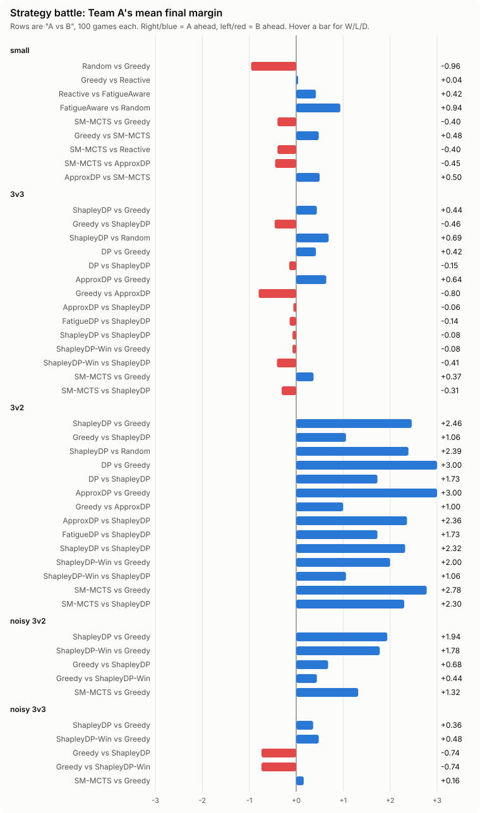

# Tug-of-War Dynamic Programming Simulator

> Real-world physical game → mathematical model → dynamic programming → simulation → experiments

A realistic Rust-based simulation that serves as an experimental laboratory for studying how algorithmic models encounter real-world complexity. Starting from a simple finite-state game, the simulator progressively introduces fatigue, heterogeneous players, switching costs, communication delays, incomplete information, and adversarial agents.

---

## The Big Picture

```text
                    REAL-WORLD GAME
                          │
                          ▼
              ┌──────────────────────┐
              │   Tug-of-War Model   │
              │ ropes • players •    │
              │ fatigue • time       │
              └──────────┬───────────┘
                         │
                         ▼
                 Mathematical Model
                         │
             ┌───────────┼───────────┐
             ▼           ▼           ▼
           STATE       ACTION      REWARD
             │           │           │
             └───────────┼───────────┘
                         ▼
                  Dynamic Programming
                         │
             ┌───────────┼───────────┐
             ▼           ▼           ▼
           Exact       Approx.      Other
            DP           DP        Strategies
             │           │           │
             └───────────┼───────────┘
                         ▼
                    SIMULATION
                         │
                         ▼
                  EXPERIMENTS
                         │
                         ▼
                 EMPIRICAL RESULTS
```

---

## Why This Project?

Dynamic programming is usually taught using deliberately clean problems: grids, knapsack, scheduling, paths, and similar abstractions.

Real-world problems are rarely that clean.

This project uses a physical tug-of-war game as a controlled laboratory for studying what happens when algorithmic models encounter real-world complexity.

Starting from a simple finite-state game, the simulator progressively introduces fatigue, heterogeneous players, switching costs, communication delays, incomplete information, stochastic behavior, and adversarial agents.

Each additional mechanic forces a question:

**What information must now become part of the state?**

This makes the project less about implementing one DP algorithm and more about learning how to transform a messy real-world system into a formally solvable optimization problem.

---

## The Game

### Visual Representation

```
TEAM A                                      TEAM B

 A A A                                       B B B
   \                                           /
    \                                         /
─────┬───────────────┬───────────────────────┬─────
     │      R1       │        R2             │ R3
     │    [⚙ ⚙]      │      [⚙ ⚙ ⚙]         │
─────┴───────────────┴───────────────────────┴─────
           ←──────────────→
             rope position
```

### Rope Properties

```
ROPE 1       ROPE 2       ROPE 3
Weight: 1    Weight: 2    Weight: 3
Value:  1    Value:  2    Value:  3
Position:    Position:    Position:
-3.2         +1.7         -0.4
```

### Core Mechanics

- **Teams**: Two teams (A and B) compete over multiple weighted ropes
- **Players**: Each team has players with strength, stamina, and fatigue characteristics
- **Ropes**: Each rope has a position, weight, and point value
- **Objective**: Pull ropes into your territory to score points
- **Time**: Game lasts for a finite number of turns
- **Fatigue**: Players tire while pulling and recover while resting

---

## From Reality to DP

The central challenge: **What information from the past is actually necessary to make the next decision?**

### State Definition

**Basic Exact DP**
```
S = (t, x₁, x₂, ..., x_R)
```
where `t` = time, `x_i` = rope position. This is only enough when teams can fully reallocate every turn at no cost (the arena games).

**With switching limits and costs** (the small and default games)
```
S = (t, x₁, ..., x_R, assignment of each player, stamina of each player)
```
Switching costs stamina (which scales pulling force) and the per-turn switch limit makes the reachable allocations depend on where players stand now. Keying on positions alone merged distinct states: the small game has ~724,000 states, not 91.

**Fatigue-Aware DP**
```
S = (t, x₁, ..., x_R, E_A, E_B)
```
where `E_A`, `E_B` = team energy (compressed)

Each additional state variable changes the computational complexity of the exact solution.

### Action Space

```
action = (a₁, a₂, ..., a_R)
```
where `a_i` = number of players on rope i, `Σ a_i = P`

Number of allocations: `C(P + R - 1, R - 1)`

### Transition Function

```
T: S × A_A × A_B → S'
```

1. Apply player movements
2. Calculate pulling forces
3. Update rope positions
4. Update stamina (fatigue/recovery)
5. Advance time

### Bellman Recurrence

Sequential maximin (`DP`), which assumes B sees A's move first:
```
V_t(S) = max_{a_A ∈ A_A(S)} min_{a_B ∈ A_B(S)} V_{t+1}(T(S, a_A, a_B))
```

Both teams actually move **simultaneously**, so the correct recurrence (Shapley, 1953; `ShapleyDP`) takes the value of a matrix game at each state, which may need mixed strategies:
```
M_S[a_A][a_B] = E[ V_{t+1}(S') | S, a_A, a_B ]        (expectation over chance with stochastic physics)
V_t(S)        = max_{x ∈ Δ(A_A)} min_{a_B} Σ_{a_A} x(a_A) · M_S[a_A][a_B]     (solved by LP)
```
Sequential maximin is a lower bound for A on the true value. See [docs/research-solution-methods.md](docs/research-solution-methods.md).

---

## Model Evolution

```text
                    MODEL EVOLUTION

       ┌─────────────────────────────┐
       │ Simple Tug-of-War           │
       │ position + time             │
       └──────────────┬──────────────┘
                      │
                      ▼
       ┌─────────────────────────────┐
       │ Multiple Ropes              │
       │ + rope positions            │
       └──────────────┬──────────────┘
                      │
                      ▼
       ┌─────────────────────────────┐
       │ Multiple Players            │
       │ + allocations               │
       └──────────────┬──────────────┘
                      │
                      ▼
       ┌─────────────────────────────┐
       │ Fatigue                     │
       │ + energy                    │
       └──────────────┬──────────────┘
                      │
                      ▼
       ┌─────────────────────────────┐
       │ Heterogeneous Players       │
       │ + individual attributes     │
       └──────────────┬──────────────┘
                      │
                      ▼
       ┌─────────────────────────────┐
       │ Switching / Coordination    │
       │ + action constraints        │
       └──────────────┬──────────────┘
                      │
                      ▼
       ┌─────────────────────────────┐
       │ Commander / Delayed Info    │
       │ + communication state       │
       └──────────────┬──────────────┘
                      │
                      ▼
       ┌─────────────────────────────┐
       │ Spies / Hidden Information  │
       │ + hidden state              │
       └──────────────┬──────────────┘
                      │
                      ▼
                ┌────────────┐
                │ DP becomes │
                │ insufficient│
                │ / changes  │
                └────────────┘
```

---

## State Explosion

The central problem is not writing the recurrence. It is controlling the size of the state.

```text
                 STATE SPACE

Basic
████

+ ropes
████████

+ players
██████████████████

+ fatigue
████████████████████████████

+ heterogeneous players
████████████████████████████████████████

+ communication
████████████████████████████████████████████████

+ hidden information
████████████████████████████████████████████████████████████
```

### Complexity Summary

| Configuration | States | Actions | Time Complexity | Exact DP |
|--------------|-------|---------|----------------|----------|
| 3v3, 2 ropes, 10 turns | 1,210 | 4 | ~2,000 | ✓ |
| 6v6, 3 ropes, 20 turns | 185,220 | 28 | ~145M | ⚠️ |
| 12v12, 3 ropes, 60 turns | 555,660 | 91 | ~4.6B | ❌ |
| + fatigue (20 buckets) | 222M | 91 | ~18B | ❌ |

---

## Architecture

### Engine/Solver Separation

```text
                         ┌───────────────┐
                         │ Configuration │
                         └───────┬───────┘
                                 │
                                 ▼
┌───────────┐              ┌──────────────┐
│ Strategy A│─────────────▶│              │
└───────────┘              │ Game Engine  │
                           │              │
┌───────────┐              │              │
│ Strategy B│─────────────▶│              │
└───────────┘              └──────┬───────┘
                                  │
                                  ▼
                           ┌─────────────┐
                           │ Game State  │
                           └──────┬──────┘
                                  │
                    ┌─────────────┼─────────────┐
                    ▼             ▼             ▼
                 Physics      Fatigue       Scoring
                    │             │             │
                    └─────────────┼─────────────┘
                                  ▼
                             Experiment
                               Runner
                                  │
                    ┌─────────────┼─────────────┐
                    ▼             ▼             ▼
                 Win Rate      Score        Energy
```

### Strategy Layer

```text
                    STRATEGY LAYER
                         │
        ┌────────────────┼────────────────┐
        ▼                ▼                ▼
      Greedy          Reactive            DP
                                           │
                                  ┌────────┴────────┐
                                  ▼                 ▼
                              Exact DP         Approx DP
```

---

## Features

### Core Simulation
- **Realistic Physics**: Weight-based rope movement with configurable thresholds
- **Player Model**: Individual strength, stamina, fatigue rates, recovery rates
- **Game Mechanics**: Time advancement, scoring, rope ownership
- **Configurable Rules**: Game duration, position ranges, switching constraints

### Strategy Framework
- **Strategy Trait**: Common interface for all decision-making approaches
- **Implemented Strategies**:
  - `RandomStrategy`: Random player allocation
  - `GreedyStrategy`: Always allocate to highest-value rope
  - `ReactiveStrategy`: Consider rope position and opponent allocation
  - `FatigueAwareStrategy`: Conserve energy early, commit late
  - `DPStrategy`: Exact minimax dynamic programming (small games)
  - `FatigueDpStrategy`: Fatigue-aware DP with compressed energy state
  - `ApproxDPStrategy`: Limited horizon beam search for large games

### Dynamic Programming
- **Exact Minimax DP**: Sequential maximin (A commits, B responds) with memoization. A lower bound for A in the real simultaneous-move game
- **Shapley DP**: Simultaneous-move DP (Shapley, 1953). Each state is a matrix game solved by LP, giving mixed strategies for both teams. Objectives: expected score margin, or win probability (`ShapleyDP-Win`)
- **SM-MCTS**: Simultaneous-move Monte Carlo Tree Search with regret matching (Lisý et al., 2013). Approximates Shapley DP from the current state when exact DP is too slow
- **Allocation Generation**: Efficient combinatorial algorithm for player distributions
- **Feasibility Estimation**: State space analysis to predict computational requirements
- **Policy Extraction**: Store optimal actions for each state
- **Fatigue-Aware DP**: Extended state with compressed energy buckets
- **Approximate Methods**: Limited horizon beam search for large state spaces
- **Arena Games**: 3v3 and 3v2 repeated Colonel Blotto games (two light ropes, 6 turns, free switching) where strategy matters and exact DP finishes in under a second

### Advanced Mechanics
- **Heterogeneous Players**: Strong, Normal, Weak player classes with different attributes
- **Switching Constraints**: Configurable limits and costs for rope switching
- **Commander System**: Communication delay and command cooldown mechanics
- **Information Models**: Perfect, local, and delayed information options
- **Spy System**: Hidden adversarial agents with configurable behavior

### Experiment Framework
- **Batch Simulation**: Run thousands of games with multi-threading
- **Statistics Collection**: Win rates, scores, energy usage, rope control
- **Strategy Comparison**: Tabular comparison of algorithm performance
- **CSV Export**: Export results for further analysis

### Interactive UI
- **egui/eframe Interface**: Modern Rust GUI framework
- **Arena Visualization**: Real-time rope position display
- **Player Panels**: Team composition and energy monitoring
- **Game Controls**: Start, pause, step, reset with speed control
- **Strategy Selection**: Dynamic strategy switching between games; slow solvers are only offered on game sizes they can handle
- **DP Inspector**: On arena games, shows the Shapley DP game value and both teams' optimal mixed strategies for the current turn

---

## Research Questions

This project explores questions such as:

1. How does the definition of the state change as realism increases?
2. Which physical variables are necessary for an optimal policy?
3. When does exact dynamic programming become computationally infeasible?
4. How much performance is lost through state compression?
5. When does a problem stop being naturally expressible as deterministic DP?
6. How do greedy, reactive, fatigue-aware, exact DP, and approximate strategies behave under different game configurations?
7. How does player heterogeneity affect optimal allocation?
8. How valuable is information about the opponent?
9. How do communication delays affect coordination?
10. Can a strategy discovered in simulation produce useful insight about the corresponding real-world game?

---

## Documentation

This project includes comprehensive mathematical and methodological documentation:

- **[docs/real-world-to-dp.md](docs/real-world-to-dp.md)**: Systematic methodology for converting real-world problems into DP formulations
- **[docs/mathematical-model.md](docs/mathematical-model.md)**: Complete mathematical formulation of the tug-of-war model
- **[docs/dp-formulation.md](docs/dp-formulation.md)**: State, action, transition, recurrence, base cases, policy, complexity
- **[docs/pseudocode.md](docs/pseudocode.md)**: Language-independent pseudocode for all algorithms
- **[docs/model-evolution.md](docs/model-evolution.md)**: How the model changes as features are added progressively
- **[docs/complexity.md](docs/complexity.md)**: Detailed state/action-space analysis and scalability limits
- **[docs/validation.md](docs/validation.md)**: Systematic validation methodology for models, algorithms, and implementations
- **[docs/experiments.md](docs/experiments.md)**: Guide to running experiments and comparing strategies
- **[docs/problem-modeling-template.md](docs/problem-modeling-template.md)**: Reusable worksheet for new problems
- **[docs/readme-review-notes.md](docs/readme-review-notes.md)**: Earlier README review and what was done from it
- **[docs/research-solution-methods.md](docs/research-solution-methods.md)**: Sourced survey of solution methods (Blotto, Shapley, SM-MCTS, CFR, PSRO, ...) mapped to model levels

---

## Project Structure

```
src/
├── main.rs                 # GUI application entry point
├── lib.rs                  # Library exports
├── game/                   # Core simulation
│   ├── mod.rs
│   ├── state.rs            # GameState, time management
│   ├── player.rs           # Player attributes, fatigue
│   ├── rope.rs             # Rope properties, movement
│   ├── rules.rs            # Game configuration
│   ├── physics.rs          # Force calculation, movement
│   ├── simulation.rs       # Game step, scoring
│   ├── factory.rs         # Game creation helpers
│   ├── player_class.rs     # Heterogeneous player classes
│   ├── switching.rs        # Switching constraints
│   ├── commander.rs        # Commander mechanics
│   ├── information.rs      # Information models
│   └── spy.rs              # Spy mechanics
├── strategies/             # Decision-making algorithms
│   ├── mod.rs
│   ├── strategy.rs         # Strategy trait, actions
│   ├── random.rs           # Random strategy
│   ├── greedy.rs           # Greedy strategy
│   ├── reactive.rs         # Reactive strategy
│   └── fatigue.rs          # Fatigue-aware strategy
├── algorithms/             # DP and optimization
│   ├── mod.rs
│   ├── allocation.rs       # Allocation generation
│   ├── dp.rs               # Minimax DP solver
│   ├── fatigue_dp.rs       # Fatigue-aware DP
│   └── approximate_dp.rs   # Limited horizon DP
├── experiments/            # Batch testing
│   ├── mod.rs
│   ├── runner.rs           # Experiment execution
│   ├── metrics.rs          # Statistics, comparison tables
│   └── export.rs           # CSV export
└── ui/                     # GUI components
    ├── mod.rs
    └── app.rs              # Main application
```

---

## Installation

### Prerequisites
- Rust 1.70 or later
- Cargo

### Build
```bash
cargo build --release
```

### Run
```bash
# Run the GUI application
cargo run --release

# Run simulation tests
cargo run --bin test_simulation

# Run DP solver tests (exact DP is exponential; ~1-4 min)
cargo run --release --bin test_dp

# Run experiment tests (includes DP matchups; ~4 min in release)
cargo run --release --bin test_experiments

# Run unit tests
cargo test
```

---

## Usage Examples

### Basic Simulation
```rust
use tug_of_war::game::{create_default_game};
use tug_of_war::strategies::{GreedyStrategy, ReactiveStrategy, Strategy};
use tug_of_war::game::simulation::{step, calculate_score};

let mut state = create_default_game();
let mut strategy_a = GreedyStrategy::new();
let mut strategy_b = ReactiveStrategy::new();

while !state.finished() {
    let action_a = strategy_a.decide(&state, Team::A);
    let action_b = strategy_b.decide(&state, Team::B);
    step(&mut state, &action_a, &action_b);
}

let score = calculate_score(&state);
println!("Final score: A={}, B={}", score.team_a, score.team_b);
```

### Dynamic Programming
```rust
use tug_of_war::algorithms::{DpSolver, DpFeasibilityEstimator};

// Check feasibility
let estimator = DpFeasibilityEstimator::new(3, 2, 10, 5);
println!("{}", estimator.report());

// Solve exactly
let mut solver = DpSolver::new(3, 2);
let value = solver.solve(&state);
println!("Optimal value: {}", value);

// Get optimal action
if let Some(allocation) = solver.get_optimal_action(&state) {
    println!("Optimal allocation: {:?}", allocation.counts);
}
```

### Batch Experiments
```rust
use tug_of_war::experiments::{ExperimentRunner, ExperimentConfig, StrategyType, GameSize};

let config = ExperimentConfig {
    number_of_games: 1000,
    random_seed: 42,
    team_a_strategy: StrategyType::Greedy,
    team_b_strategy: StrategyType::Reactive,
    game_size: GameSize::Small,
    strength_variation: 0.2,
};

let runner = ExperimentRunner::new(config);
let results = runner.run();
println!("{}", results);
```

---

## Configuration

Default game configuration:
- **Teams**: 2 (A and B)
- **Players per team**: 12
- **Ropes**: 3 (weights: 1, 2, 3; values: 1, 2, 3)
- **Duration**: 60 time steps
- **Position range**: ±10 units
- **Switching limit**: 4 players per turn
- **Fatigue**: Enabled

Small game (for DP testing):
- **Players per team**: 3
- **Ropes**: 2
- **Duration**: 10 time steps
- **Position range**: ±5 units

---

## Experimental Results

> **Status:** Example output shown below. These numbers are illustrative and should not be interpreted as scientifically validated results unless accompanied by the corresponding experiment configuration, seed, model version, and reproducibility information.

Example results (100 games each, seed 42, `strength_variation: 0.2`). Rows are "A vs B"; "Avg Score" is Team A's mean final score differential. Plain rows use the small game, `[small]` rows too; `[3v3]`/`[3v2]` rows use the arena games; `[noisy ...]` rows use the arena games with stochastic physics. Run with `cargo run --release --bin test_experiments` (~15 min).

```
Strategy                 Wins   Losses    Draws Win Rate  Avg Score
--------                 ----   ------    ----- --------  ---------
Random vs Greedy            1       99        0     1.0      -0.96
Greedy vs Reactive         24       26       50    24.0       0.04
Reactive vs FatigueAware       40       10       50    40.0       0.42
FatigueAware vs Random       97        3        0    97.0       0.94
[small] SM-MCTS vs Greedy       13       75       12    13.0      -0.40
[small] Greedy vs SM-MCTS       77       13       10    77.0       0.48
[small] SM-MCTS vs Reactive       13       75       12    13.0      -0.40
[small] SM-MCTS vs ApproxDP       14       74       12    14.0      -0.45
[small] ApproxDP vs SM-MCTS       78       12       10    78.0       0.50
[3v3] ShapleyDP vs Greedy       34       38       28    34.0       0.44
[3v3] Greedy vs ShapleyDP       34       38       28    34.0      -0.46
[3v3] ShapleyDP vs Random       67       22       11    67.0       0.69
[3v3] DP vs Greedy         34       38       28    34.0       0.42
[3v3] DP vs ShapleyDP       34       35       31    34.0      -0.15
[3v3] ApproxDP vs Greedy       34       38       28    34.0       0.64
[3v3] Greedy vs ApproxDP       34       38       28    34.0      -0.80
[3v3] ApproxDP vs ShapleyDP       34       36       30    34.0      -0.06
[3v3] FatigueDP vs ShapleyDP       34       32       34    34.0      -0.14
[3v3] ShapleyDP vs ShapleyDP       34       38       28    34.0      -0.08
[3v3] ShapleyDP-Win vs Greedy       34       38       28    34.0      -0.08
[3v3] ShapleyDP-Win vs ShapleyDP       34       33       33    34.0      -0.41
[3v3] SM-MCTS vs Greedy       34       53       13    34.0       0.37
[3v3] SM-MCTS vs ShapleyDP       34       51       15    34.0      -0.31
[3v2] ShapleyDP vs Greedy       99        1        0    99.0       2.46
[3v2] Greedy vs ShapleyDP      100        0        0   100.0       1.06
[3v2] ShapleyDP vs Random       97        2        1    97.0       2.39
[3v2] DP vs Greedy        100        0        0   100.0       3.00
[3v2] DP vs ShapleyDP      100        0        0   100.0       1.73
[3v2] ApproxDP vs Greedy      100        0        0   100.0       3.00
[3v2] Greedy vs ApproxDP      100        0        0   100.0       1.00
[3v2] ApproxDP vs ShapleyDP      100        0        0   100.0       2.36
[3v2] FatigueDP vs ShapleyDP      100        0        0   100.0       1.73
[3v2] ShapleyDP vs ShapleyDP       98        0        2    98.0       2.32
[3v2] ShapleyDP-Win vs Greedy      100        0        0   100.0       2.00
[3v2] ShapleyDP-Win vs ShapleyDP      100        0        0   100.0       1.06
[3v2] SM-MCTS vs Greedy      100        0        0   100.0       2.78
[3v2] SM-MCTS vs ShapleyDP      100        0        0   100.0       2.30
[noisy 3v2] ShapleyDP vs Greedy       85       15        0    85.0       1.94
[noisy 3v2] ShapleyDP-Win vs Greedy       87       13        0    87.0       1.78
[noisy 3v2] Greedy vs ShapleyDP       88       12        0    88.0       0.68
[noisy 3v2] Greedy vs ShapleyDP-Win       76       22        2    76.0       0.44
[noisy 3v2] SM-MCTS vs Greedy       77       23        0    77.0       1.32
[noisy 3v3] ShapleyDP vs Greedy       49       51        0    49.0       0.36
[noisy 3v3] ShapleyDP-Win vs Greedy       55       45        0    55.0       0.48
[noisy 3v3] Greedy vs ShapleyDP       43       57        0    43.0      -0.74
[noisy 3v3] Greedy vs ShapleyDP-Win       36       64        0    36.0      -0.74
[noisy 3v3] SM-MCTS vs Greedy       44       56        0    44.0       0.16
```



Regenerate the chart after running experiments: `python3 scripts/plot_results.py`.

### Findings so far

1. **Winners are decided before play starts.** In the arena games, every initial state has win-probability value exactly -1, 0 or +1: with deterministic physics and perfect information, the stronger team (after the strength draw) can always force the result. Strategy only changes the *margin*, which is why win counts barely move between rows while "Avg Score" does. Win probability only becomes meaningful once uncertainty is added.
2. **With stochastic physics, the objective matters.** In the noisy arenas (each pull is a Tullock contest: the rope moves toward A with probability F_A²/(F_A²+F_B²)), maximizing win probability wins more games than maximizing expected margin in all four matchups against Greedy (as A: 87 vs 85 in 3v2, 55 vs 49 in 3v3; as B, Greedy's wins drop from 88 to 76 and from 43 to 36), usually with a smaller average margin. With 100 games the standard error is about ±5 percentage points, so individual gaps are suggestive rather than conclusive.
3. **Exploit vs. safety.** Sequential DP and ApproxDP plan against one assumed opponent and beat Greedy by more than Shapley DP does ([3v2] DP vs Greedy +3.00 vs ShapleyDP +2.46), but Shapley DP punishes them ([3v2] DP vs ShapleyDP +1.73). Shapley DP is never worse than the game value against any opponent.
4. **Shapley DP as the weaker team dodges.** In 3v2, Greedy B stacks its 2 players against A's 3 on the value-2 rope and concedes it (a +2 margin for A). Shapley DP as B cuts Greedy's margin to +1.06 by contesting the value-1 rope it can win instead.
5. **SM-MCTS approximates Shapley DP where it converges.** On the arenas it plays close to Shapley DP ([3v2] vs ShapleyDP +2.30 vs Shapley self-play +2.32). On the 10-turn small game with heavy ropes and a 2-switch limit, 1,000 iterations per turn are not enough (it loses to Greedy); it reaches parity with Greedy at about 16,000 iterations.
6. **The state is bigger than it looks.** The exact DP originally keyed states by rope positions only. Switching costs stamina and switches are limited, so assignments and stamina are part of the state too: the small game grows from 91 to ~724,000 states (82 s to solve in release).

---

## Performance

### DP Solver Performance
- **Small game (3v3, 2 ropes, 10 turns)**: ~7ms, 91 states cached
- **Medium game (4v4, 3 ropes, 20 turns)**: ~500ms, ~1,000 states cached
- **Large game (12v12, 3 ropes, 60 turns)**: Infeasible for exact DP

### Experiment Runner
- **100 games**: ~2 seconds (multi-threaded)
- **1,000 games**: ~15 seconds
- **10,000 games**: ~2 minutes

---

## Project Status

### Completed Phases
- ✅ Phase 1: Core simulation with realistic physics
- ✅ Phase 2: Strategy framework and baseline algorithms  
- ✅ Phase 3: Interactive GUI with arena visualization
- ✅ Phase 4: Exact DP solver with feasibility analysis
- ✅ Phase 5: Experiment framework and batch testing
- ✅ Phase 6: Fatigue system and fatigue-aware DP
- ✅ Phase 7: Advanced mechanics (heterogeneous players, switching, commander)
- ✅ Phase 8: Advanced game theory (partial information, spies, approximate DP)

### Key Achievements
1. **Clean Architecture**: Perfect separation between game engine and strategy solvers
2. **Realistic Simulation**: Configurable complexity from simple to complex
3. **Working DP**: Exact minimax DP works for small state spaces with feasibility analysis
4. **Experimental Platform**: Strategy comparison and batch testing capabilities
5. **Interactive UI**: Real-time visualization and control
6. **Comprehensive Documentation**: Mathematical methodology and validation procedures

---

## Future Research Directions

- Continuous-state control
- Stochastic dynamic programming
- POMDP formulation
- Reinforcement learning
- Monte Carlo Tree Search
- Multi-agent reinforcement learning
- Real-world parameter calibration
- Human strategy experiments

---

## Model Assumptions

The current implementation makes these simplifying assumptions for exact DP:

✅ **Enabled**:
- Discrete time steps
- Discrete rope positions
- Perfect information
- Deterministic physics
- Simultaneous team decisions
- Finite horizon

❌ **Disabled** (for future expansion):
- Hidden information
- Random spy behavior
- Individual stochastic fatigue
- Continuous time
- Continuous rope positions

---

## Validation & Reproducibility

This project includes systematic validation procedures documented in [docs/validation.md](docs/validation.md). All experiments should record:
- Git commit hash
- Rust version
- Configuration parameters
- Random seed
- Hardware specifications
- Operating system

---

## Contributing

This is a research/educational project. Contributions are welcome, especially:
- Additional strategy implementations
- Approximate DP methods
- Enhanced UI features
- Performance optimizations
- Documentation improvements

---

## License

This project is provided as-is for educational and research purposes.

---

## Acknowledgments

This project demonstrates the application of dynamic programming and game theory to a real-world physical game, showing how algorithmic decision-making can be studied through realistic simulation.